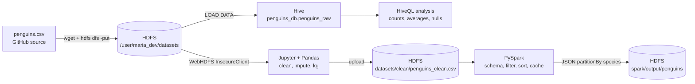

# Big Data with Hadoop: Palmer Penguins Pipeline


[](https://github.com/zeeshan123abbas/penguins-hadoop-assessment/actions/workflows/ci.yml)

### 🌐 [Live dashboard](https://zeeshan123abbas.github.io/penguins-hadoop-assessment/) · 📄 [Report (PDF)](report/Hadoop_Penguins_Assessment_Report.pdf)

An end-to-end big data pipeline on the **Palmer Penguins** dataset (344 records):
**HDFS → Hive → Python/Pandas ELT over WebHDFS → PySpark**, executed on a working Hadoop cluster as user `maria_dev`.

**Author:** Zeeshan Abbas · T3 Hadoop Assessment

---

## Pipeline architecture



## Repository structure

```
.
├── data/                 penguins.csv (source dataset)
├── hdfs/                 Section 1: HDFS CLI script
├── hive/                 Section 2: HiveQL (database, table, analysis)
├── notebooks/            Section 3: Jupyter notebook (executed, with outputs)
├── spark/                Section 4: PySpark application
├── logs/                 Real command transcripts from every task
├── screenshots/          Evidence for every practical step
├── docs/charts/          Analysis charts
├── report/               Assessment report (PDF + DOCX)
├── src/                  Reusable, tested cleaning module
├── tests/                Pytest suite (10 tests)
├── scripts/              run_all.sh: whole pipeline in one command
├── site/                 Interactive dashboard (deployed to GitHub Pages)
├── tools/                Helpers used to capture transcripts and render evidence
├── .github/workflows/    CI: syntax check + tests on every push
├── Makefile
└── requirements.txt
```

## Sections

| # | Task | File |
|---|---|---|
| 1 | HDFS: `mkdir`, download, `put`, `ls` | [`hdfs/section1_hdfs_commands.sh`](hdfs/section1_hdfs_commands.sh) |
| 2 | Hive: `penguins_db`, `penguins_raw`, preview, counts, averages, missing values | [`hive/penguins.hql`](hive/penguins.hql) |
| 3 | WebHDFS + Pandas: inspect, clean, impute, add `body_mass_kg`, upload | [`notebooks/penguins_elt_webhdfs.ipynb`](notebooks/penguins_elt_webhdfs.ipynb) |
| 4 | PySpark: schema, select, filter, sort, cache, JSON partitioned by species | [`spark/penguins_spark.py`](spark/penguins_spark.py) |

## Key results

| Metric | Value |
|---|---|
| Records loaded | 344 (342 after cleaning) |
| Adelie by island (Biscoe / Dream / Torgersen) | 44 / 56 / 52 |
| Chinstrap (Dream) · Gentoo (Biscoe) | 68 · 124 |
| Avg body mass, g (Gentoo / Chinstrap / Adelie) | 5076.02 / 3733.09 / 3700.66 |
| Avg flipper length, mm (Gentoo / Chinstrap / Adelie) | 217.19 / 195.82 / 189.95 |
| Missing values (bill length / flipper / mass / sex) | 2 / 2 / 2 / 11 |
| Cleaning | 2 empty rows dropped, numeric gaps filled with species median, sex set to `unknown` |
| Spark output (body mass ≥ 4 kg) | 177 rows → `/user/maria_dev/spark/output/penguins/species=*` |

## Screenshots

**Section 1: HDFS listing**


**Section 2: Hive species and island counts**


**Section 3: Cleaned file uploaded over WebHDFS**


**Section 4: Spark JSON output partitioned by species**


More in [`screenshots/`](screenshots/), full transcripts in [`logs/`](logs/).

## Charts

| Average by species | Species by island |
|---|---|
|  |  |

## Interactive dashboard

A web dashboard with the pipeline diagram, filterable charts, every result table and a screenshot gallery is live at **[https://zeeshan123abbas.github.io/penguins-hadoop-assessment/](https://zeeshan123abbas.github.io/penguins-hadoop-assessment/)**. Source: [`site/`](site/).

## How to run

**Prerequisites:** Hadoop (HDFS + YARN), Hive with HiveServer2, Spark 3.x, Python 3 with `pip install -r requirements.txt`.

```bash
# Everything in one go
bash scripts/run_all.sh        # or: make pipeline

# Section 1: HDFS
bash hdfs/section1_hdfs_commands.sh

# Section 2: Hive
hdfs dfs -mkdir -p /user/maria_dev/hive_stage
hdfs dfs -cp -f /user/maria_dev/datasets/penguins.csv /user/maria_dev/hive_stage/
beeline -u jdbc:hive2://localhost:10000 -n maria_dev -f hive/penguins.hql

# Section 3: Jupyter (Run All)
jupyter notebook notebooks/penguins_elt_webhdfs.ipynb

# Section 4: Spark
spark-submit --master yarn spark/penguins_spark.py     # or --master local[2]
```

> **HDP Sandbox:** set `WEBHDFS_URL = "http://sandbox-hdp.hortonworks.com:50070"` in the notebook and `HDFS_NN = "hdfs://sandbox-hdp.hortonworks.com:8020"` in the Spark script.

## Tests

The cleaning logic lives in [`src/penguins_clean.py`](src/penguins_clean.py) and is covered by [`tests/`](tests/): row counts, species counts, missing values, imputation, kg conversion and the Spark ≥ 4 kg filter (177 rows).

```bash
pip install pandas pytest
python -m pytest -q      # 10 passed
```

See [`docs/ARCHITECTURE.md`](docs/ARCHITECTURE.md) for design decisions and the issues fixed during setup.

## Environment used

Apache Hadoop 3.3.6 · Apache Hive 3.1.3 · Apache Spark 3.5.1 · OpenJDK 8 · Python 3.12 (pandas, hdfs) · single-node cluster, host `sandbox-hdp`, user `maria_dev`.

## Deliverables

- 📄 [Assessment report (PDF)](report/Hadoop_Penguins_Assessment_Report.pdf) · [DOCX](report/Hadoop_Penguins_Assessment_Report.docx)

## Dataset

Palmer Penguins by Dr. Kristen Gorman and Palmer Station LTER, via [allisonhorst/palmerpenguins](https://github.com/allisonhorst/palmerpenguins) (CC0).

## License

[MIT](LICENSE)
