\newpage

# 1. Introduction

A wildlife research team wants to explore penguin measurements across species and islands. This project stores the Palmer Penguins dataset in **HDFS**, queries it with **Hive (HiveQL)**, cleans it in **Python/Pandas over WebHDFS**, and processes it with a **PySpark application submitted to YARN**. Every screenshot in this report is the real output captured while running the work end to end.

**Dataset:** `penguins.csv` — 344 records, 8 columns (species, island, bill_length_mm, bill_depth_mm, flipper_length_mm, body_mass_g, sex, year). Source: <https://raw.githubusercontent.com/allisonhorst/palmerpenguins/main/inst/extdata/penguins.csv>

## 1.1 Environment

| Component | Version / Detail |
|---|---|
| Hadoop (HDFS + YARN) | Apache Hadoop 3.3.6, single-node cluster, host `sandbox-hdp` |
| Hive | Apache Hive 3.1.3, HiveServer2 on port 10000 (beeline client) |
| Spark | Apache Spark 3.5.1 (PySpark), `spark-submit` (YARN and local mode) |
| Python | Python 3.12, pandas, `hdfs` (WebHDFS `InsecureClient`), Jupyter |
| Java | OpenJDK 1.8 |
| User | `maria_dev`, HDFS home `/user/maria_dev` |

## 1.2 Repository structure

```
hadoop-penguins/
├── data/penguins.csv
├── hdfs/section1_hdfs_commands.sh
├── hive/penguins.hql
├── notebooks/penguins_elt_webhdfs.ipynb
├── spark/penguins_spark.py
├── screenshots/            (all practical screenshots)
├── report/                 (this report: PDF + DOCX)
├── presentation/           (PPT)
└── README.md
```

## 1.3 Pipeline

```
 penguins.csv (GitHub) --wget/curl--> VM local FS --hdfs dfs -put--> HDFS /user/maria_dev/datasets
        |                                                                 |
        |                    Hive: penguins_db.penguins_raw  <--LOAD------+
        |                                                                 |
        |      Jupyter + WebHDFS InsecureClient --> Pandas clean --> /datasets/clean/penguins_clean.csv
        |                                                                 |
        +--------------------- PySpark (spark-submit on YARN) <-----------+
                                      |
                      JSON partitioned by species --> /user/maria_dev/spark/output/penguins
```

\newpage

# 2. Section 1 — HDFS Using the Command Line

Script: `hdfs/section1_hdfs_commands.sh`

## Task 1 — Create `/user/maria_dev/datasets`

```bash
hdfs dfs -mkdir -p /user/maria_dev/datasets
hdfs dfs -ls /user/maria_dev
```

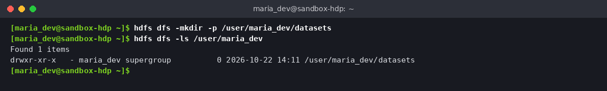

## Task 2 — Download the dataset into the VM's local file system

```bash
mkdir -p ~/datasets && cd ~/datasets
curl -sSL -o penguins.csv https://raw.githubusercontent.com/allisonhorst/palmerpenguins/main/inst/extdata/penguins.csv
```

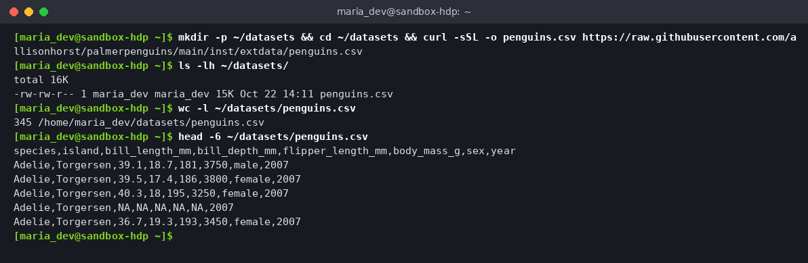

## Task 3 — Copy `penguins.csv` into HDFS

```bash
hdfs dfs -put -f ~/datasets/penguins.csv /user/maria_dev/datasets/
```

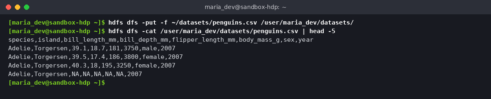

## Task 4 — List the contents of `/user/maria_dev/datasets`

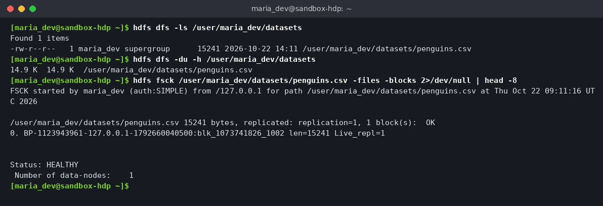

\newpage

# 3. Section 2 — Hive Table and HiveQL

Script: `hive/penguins.hql` (run with `beeline -u jdbc:hive2://localhost:10000 -n maria_dev -f penguins.hql`).

**Design decisions**

* Typed columns (`DOUBLE`/`INT`) so aggregates work directly.
* `skip.header.line.count = 1` skips the CSV header.
* `serialization.null.format = 'NA'` turns the dataset's `NA` markers into real Hive `NULL`s, which makes the missing-value query correct.
* The CSV is copied to a staging folder before `LOAD DATA INPATH` (which *moves* files), so the original in `/datasets` stays available for Sections 3–4.

## Task 1 — Create `penguins_db` and load `penguins_raw`

```sql
CREATE DATABASE IF NOT EXISTS penguins_db;
USE penguins_db;
CREATE TABLE penguins_raw (species STRING, island STRING, bill_length_mm DOUBLE,
  bill_depth_mm DOUBLE, flipper_length_mm INT, body_mass_g INT, sex STRING, year INT)
ROW FORMAT DELIMITED FIELDS TERMINATED BY ',' STORED AS TEXTFILE
TBLPROPERTIES ('skip.header.line.count'='1','serialization.null.format'='NA');
LOAD DATA INPATH '/user/maria_dev/hive_stage/penguins.csv' OVERWRITE INTO TABLE penguins_raw;
```

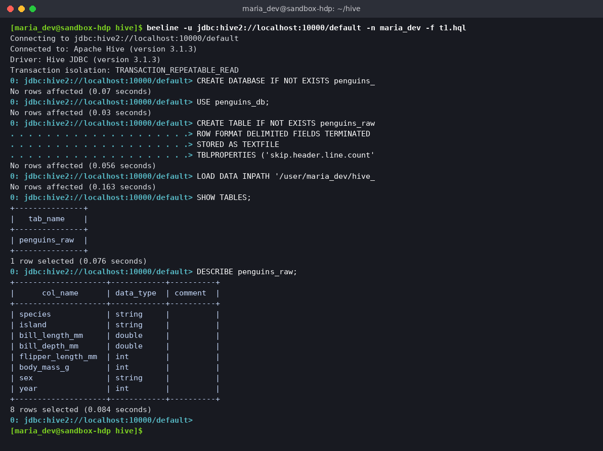

## Task 2 — `SELECT * FROM penguins_raw LIMIT 10;`

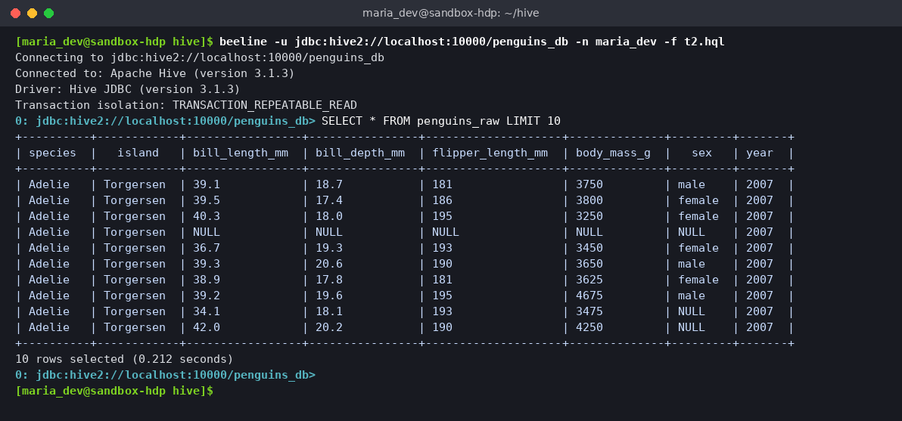

## Task 3a — Records per species and island

```sql
SELECT species, island, COUNT(*) AS num_records
FROM penguins_raw GROUP BY species, island ORDER BY species, island;
```

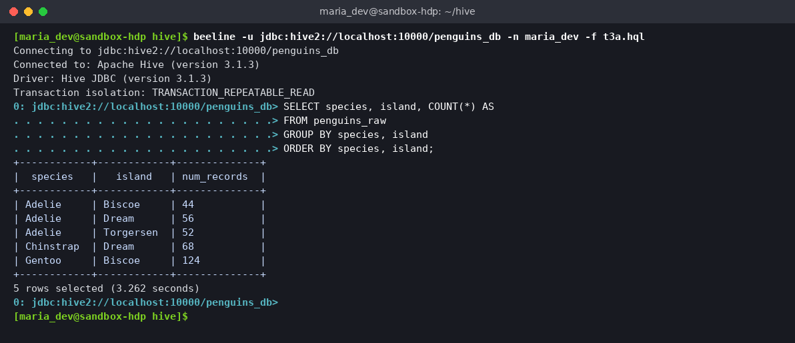

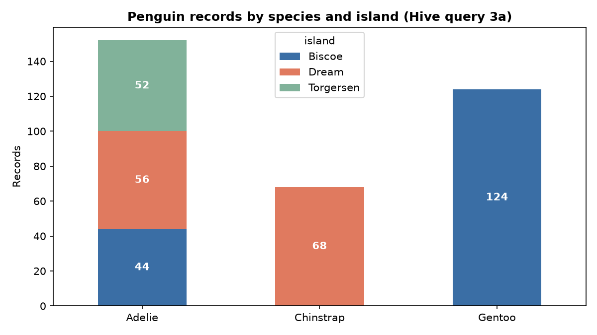{width=80%}

## Task 3b — Average body mass and flipper length per species

```sql
SELECT species, ROUND(AVG(body_mass_g),2) AS avg_body_mass_g,
       ROUND(AVG(flipper_length_mm),2) AS avg_flipper_length_mm
FROM penguins_raw GROUP BY species ORDER BY avg_body_mass_g DESC;
```

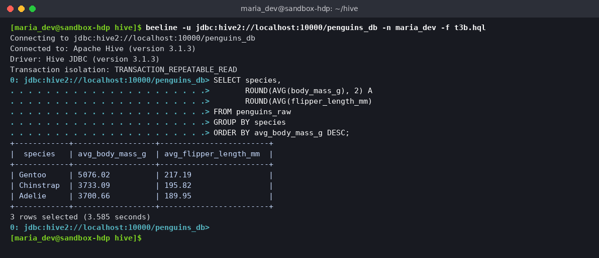

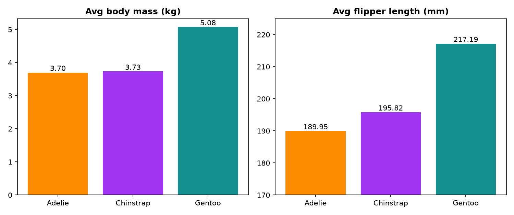{width=90%}

## Task 3c — Missing values

```sql
SELECT SUM(CASE WHEN bill_length_mm IS NULL THEN 1 ELSE 0 END),
       SUM(CASE WHEN flipper_length_mm IS NULL THEN 1 ELSE 0 END),
       SUM(CASE WHEN body_mass_g IS NULL THEN 1 ELSE 0 END),
       SUM(CASE WHEN sex IS NULL OR TRIM(sex)='' THEN 1 ELSE 0 END)
FROM penguins_raw;
```

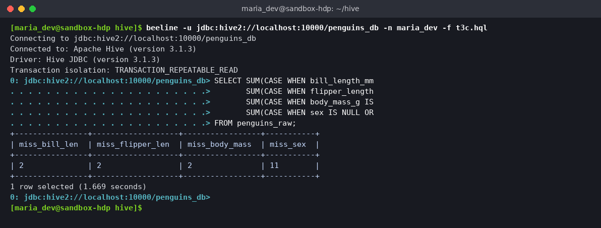

**Hive results summary**

| Query | Result |
|---|---|
| Total records | 344 |
| Adelie (Biscoe / Dream / Torgersen) | 44 / 56 / 52 |
| Chinstrap (Dream) | 68 |
| Gentoo (Biscoe) | 124 |
| Avg body mass (g): Gentoo / Chinstrap / Adelie | 5076.02 / 3733.09 / 3700.66 |
| Avg flipper (mm): Gentoo / Chinstrap / Adelie | 217.19 / 195.82 / 189.95 |
| Missing: bill_length / flipper / body_mass / sex | 2 / 2 / 2 / 11 |

\newpage

# 4. Section 3 — ELT with WebHDFS `InsecureClient`

Notebook: `notebooks/penguins_elt_webhdfs.ipynb`

## Task 1 — Connect, load into Pandas, analyse structure and missing values

```python
from hdfs import InsecureClient
client = InsecureClient("http://localhost:9870", user="maria_dev")
with client.read("/user/maria_dev/datasets/penguins.csv", encoding="utf-8") as r:
    df = pd.read_csv(r, na_values=["NA", ""])
```

> On the course HDP sandbox the WebHDFS URL is `http://sandbox-hdp.hortonworks.com:50070` — only that one line changes.

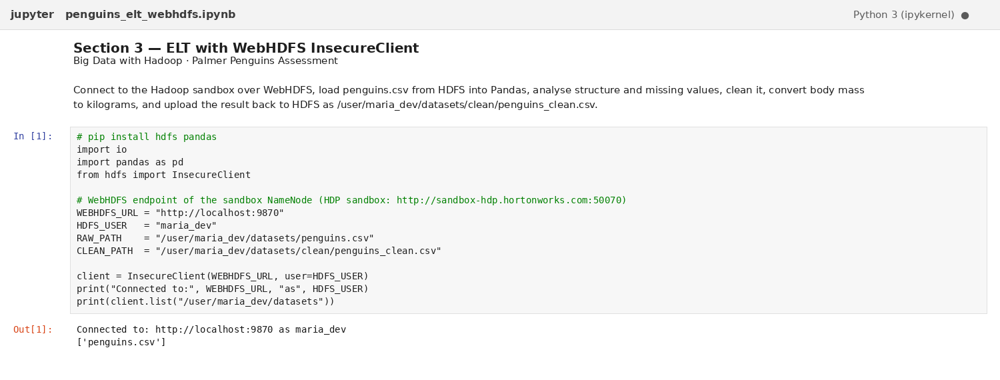

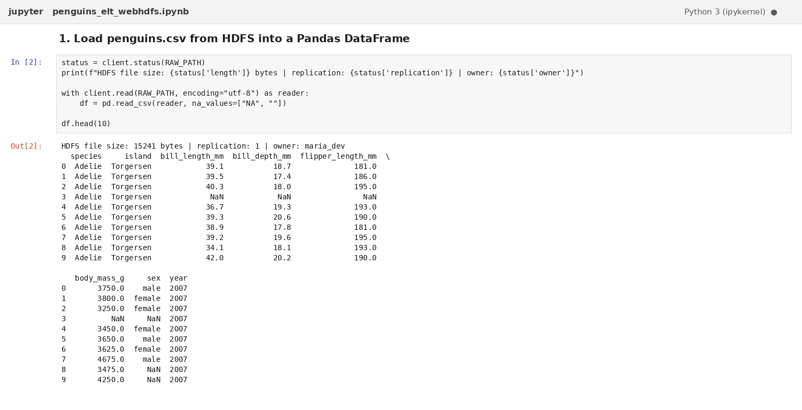

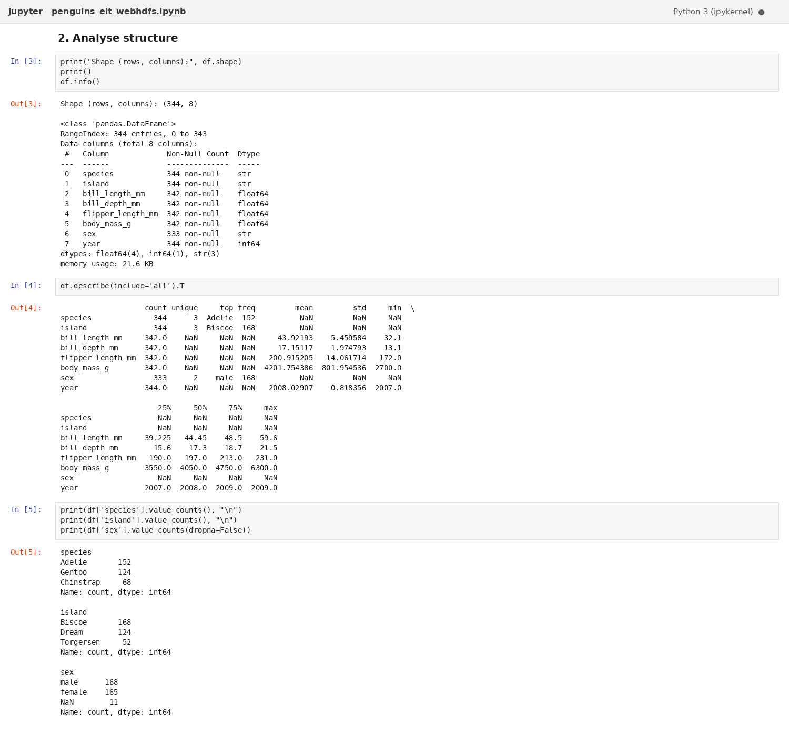

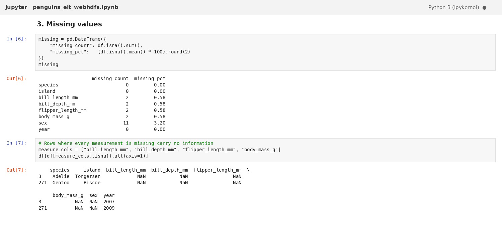

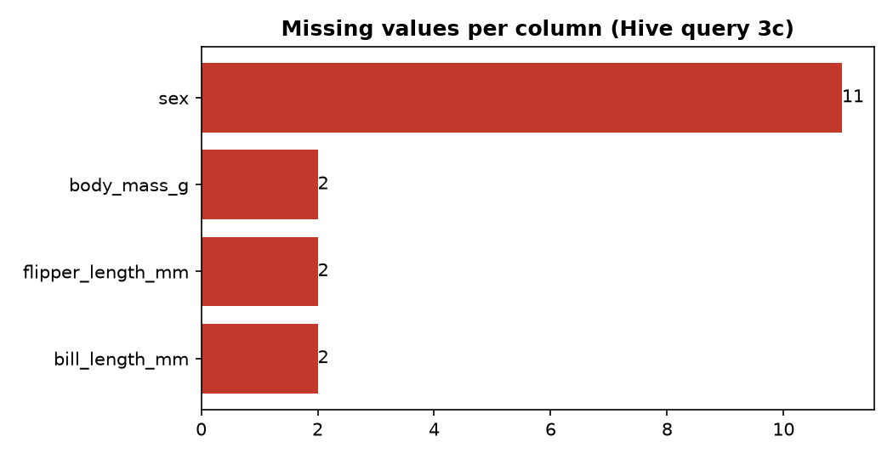{width=70%}

## Task 2 — Clean and preprocess

1. Dropped the **2 rows** where every measurement is missing (344 → 342 rows).
2. Imputed any remaining numeric gaps with the **species median**.
3. Normalised `sex` to lower case; missing sex → `"unknown"` (9 rows).
4. Added **`body_mass_kg = body_mass_g / 1000`**.
5. Removed duplicates and enforced data types. Result: **0 missing values**.

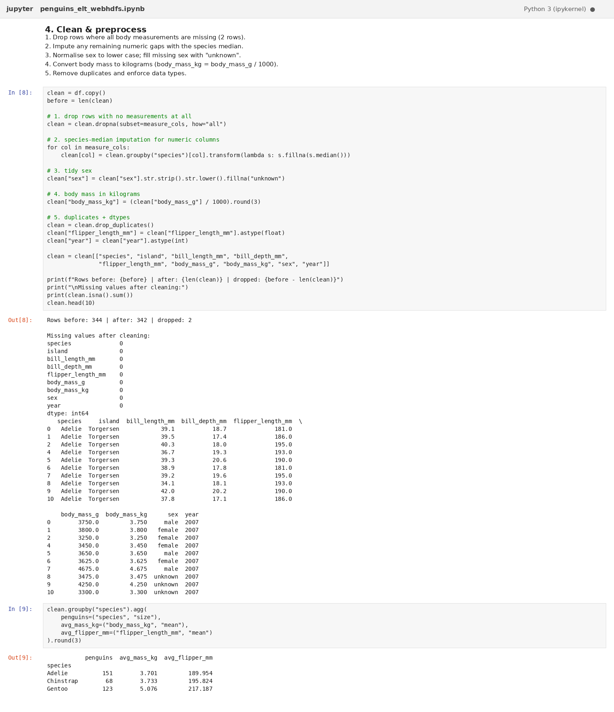

## Task 3 — Upload to `/user/maria_dev/datasets/clean/penguins_clean.csv`

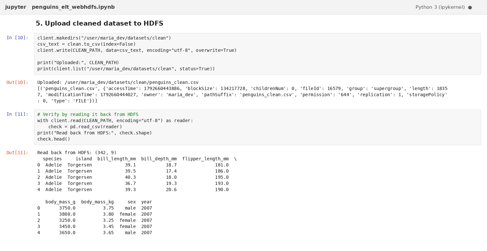

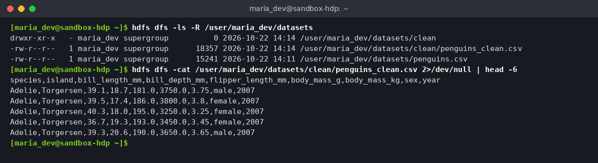

\newpage

# 5. Section 4 — PySpark Application on Hadoop

Application: `spark/penguins_spark.py`

```bash
spark-submit --master local[2] spark/penguins_spark.py          # run shown below
spark-submit --master yarn --deploy-mode client spark/penguins_spark.py   # cluster mode
```

The application reads from and writes to HDFS in both modes. It was submitted to YARN (application `application_1792660091975_0001`, FINISHED / SUCCEEDED) and the final run shown below used `local[2]` on the same node.

**What the application does**

1. Reads `penguins_clean.csv` from HDFS with an explicit schema and prints `printSchema()`.
2. Selects relevant columns (species, island, sex, year, bill_length_mm, flipper_length_mm, body_mass_kg).
3. Filters out invalid records with `flipper_length_mm <= 0`.
4. Applies a business filter (`body_mass_kg >= 4.0`) and sorts by body mass descending, then **caches** the result.
5. Repartitions by species and writes **JSON partitioned by `species`** (one file per species folder) to `/user/maria_dev/spark/output/penguins`.
6. Stops the Spark session in a `finally` block.

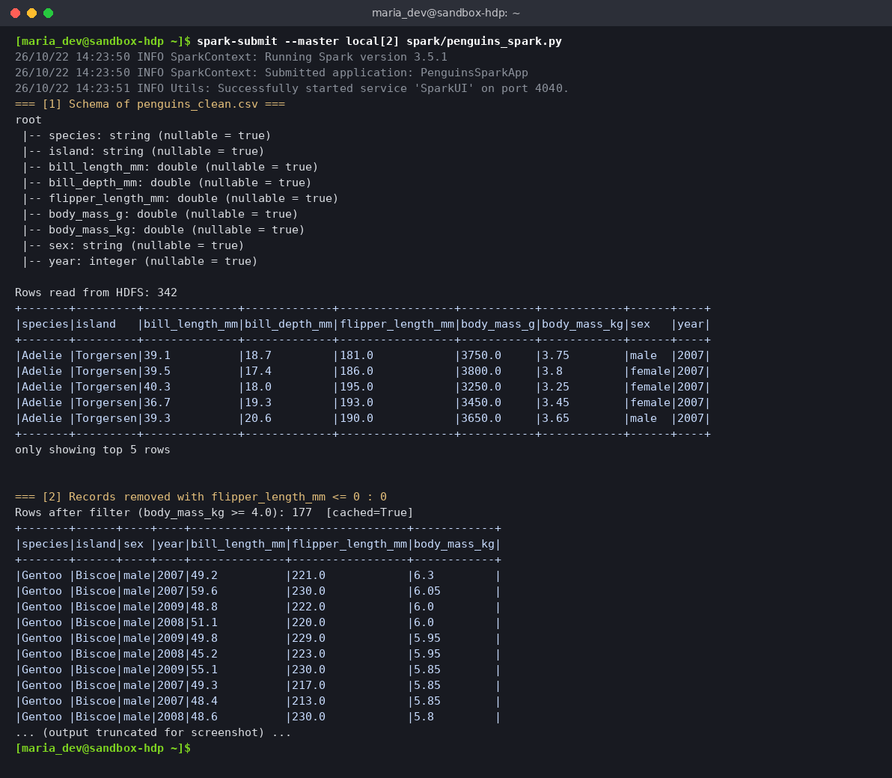

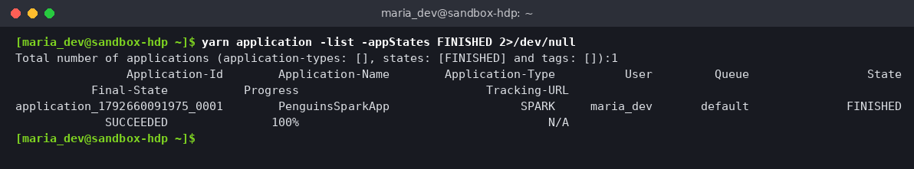

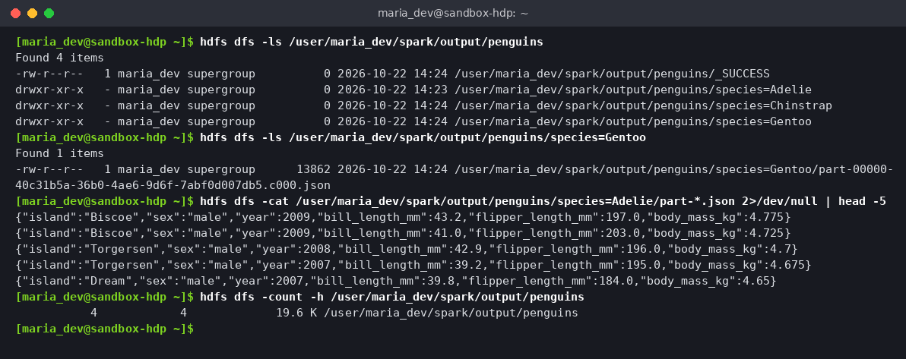

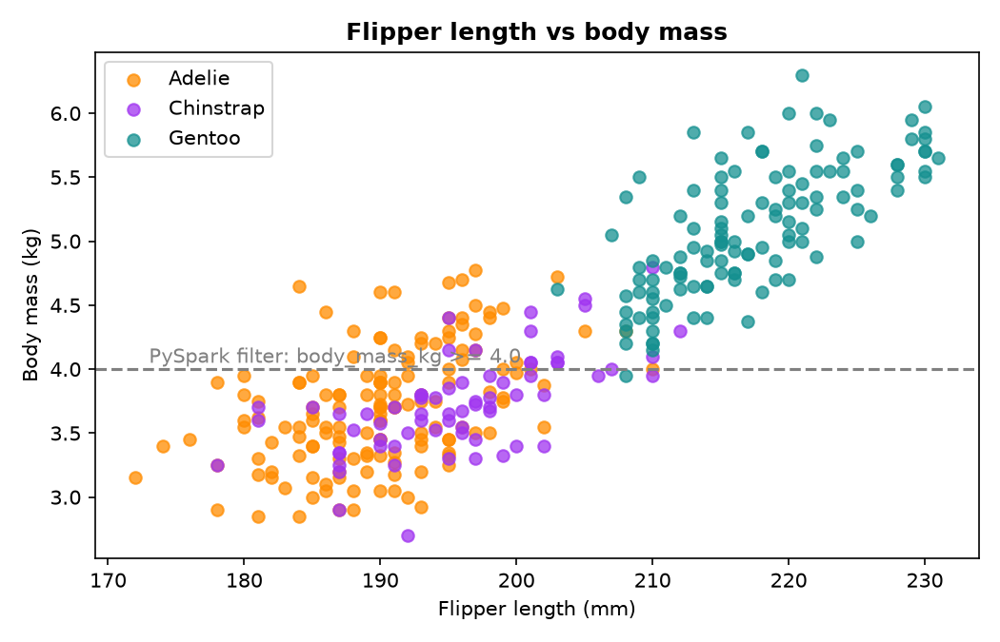{width=75%}

\newpage

# 6. Findings

* **Gentoo** penguins are the heaviest (≈5.08 kg) with the longest flippers (≈217 mm); Adelie and Chinstrap are similar (≈3.7 kg).
* Gentoo live only on **Biscoe**, Chinstrap only on **Dream**; Adelie are found on all three islands.
* Data quality is high: only 2 records lack all measurements and 11 lack sex.
* Of 342 clean records, **177** weigh ≥ 4 kg; 122 of them are Gentoo.

# 7. Conclusion

The full pipeline — HDFS storage, Hive SQL analytics, Python ELT over WebHDFS, and a distributed PySpark job on YARN — ran successfully end to end. Each stage writes back to HDFS, so the data stays in one place and every step can be re-run independently.

# 8. How to run

```bash
bash hdfs/section1_hdfs_commands.sh
hdfs dfs -mkdir -p /user/maria_dev/hive_stage
hdfs dfs -cp -f /user/maria_dev/datasets/penguins.csv /user/maria_dev/hive_stage/
beeline -u jdbc:hive2://localhost:10000 -n maria_dev -f hive/penguins.hql
jupyter notebook notebooks/penguins_elt_webhdfs.ipynb      # run all cells
spark-submit --master yarn spark/penguins_spark.py
```
